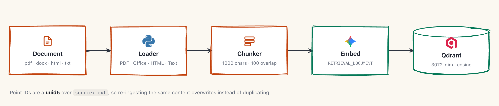
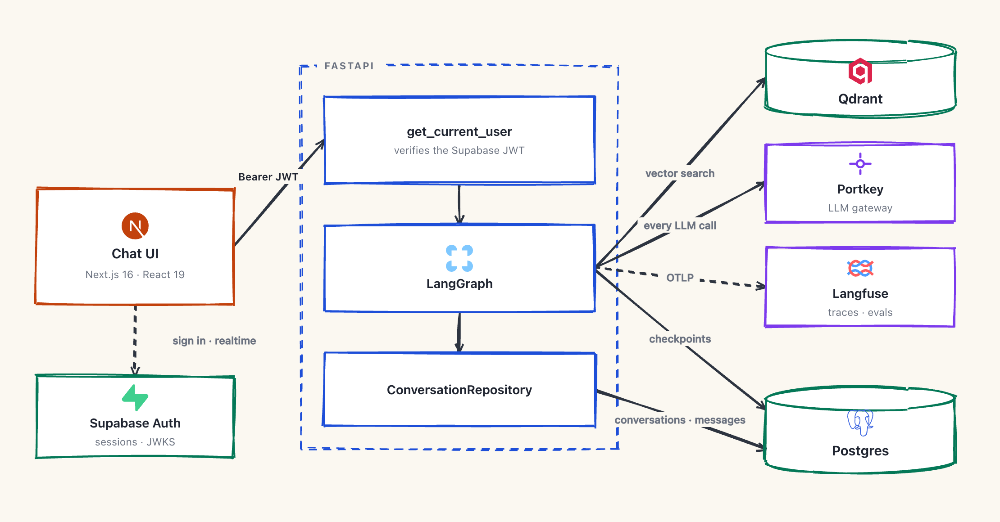
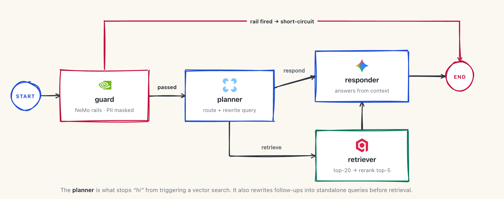
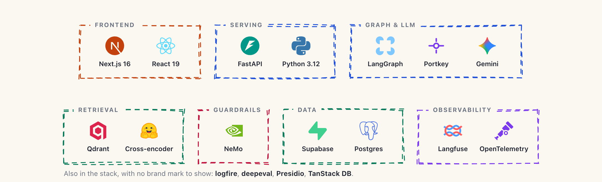

# Sage

A retrieval-augmented generation system for enterprise IT questions (Kubernetes, Intel hardware, enterprise networking), built as a LangGraph state machine behind a FastAPI service with a Next.js chat frontend.

The part worth looking at is the **planner node**. A naive RAG pipeline embeds and searches on every turn, so "hi" and "thanks" both trigger a vector search. Here a planner runs first and decides whether retrieval is needed at all, and when it is, rewrites the user's message into a standalone search query so follow-ups like "what about scaling it?" resolve their pronouns before they ever reach Qdrant.

---

## Architecture

### 1. Ingestion (offline)

Run manually via CLI. Documents are parsed, split, embedded as documents, and upserted into Qdrant with deterministic IDs.

<picture>
  <source media="(prefers-color-scheme: dark)" srcset="docs/architecture/ingest-dark.png">
  
</picture>

Point IDs are a `uuid5` over `source:text`, so re-ingesting the same content overwrites rather than duplicates. `--skip-existing` skips files whose source label is already in the collection.

### 2. System

<picture>
  <source media="(prefers-color-scheme: dark)" srcset="docs/architecture/system-dark.png">
  
</picture>

Postgres holds two independent things: the application's own `conversations` / `messages` tables (what the sidebar reads) and LangGraph's `PostgresSaver` checkpoint tables (what gives the graph its memory across turns). Row-level security is enabled on the checkpoint tables at startup.

### 3. The graph

<picture>
  <source media="(prefers-color-scheme: dark)" srcset="docs/architecture/graph-dark.png">
  
</picture>

| Node | What it does |
|---|---|
| `guard` | NeMo Guardrails input rails. Two outcomes: a rail **fires** and the graph short-circuits to `END` with the rail's response, or the turn passes. PII is **masked, not blocked**. Presidio rewrites `PERSON`, `EMAIL_ADDRESS`, `PHONE_NUMBER`, `CREDIT_CARD`, `US_SSN`, `IP_ADDRESS`, `IBAN_CODE` in place, and the masked text replaces the original message in state so nothing downstream ever sees the raw value. |
| `planner` | One structured-output LLM call returning `{route, search_query}` over the last 4 messages. `route` decides whether the knowledge base is needed; `search_query` is a standalone rewrite of the request. |
| `retriever` | Two-stage: embed the query with `RETRIEVAL_QUERY` → Qdrant top-20 → cross-encoder rerank to top-5. The first stage is fast and recall-oriented, the second is slow and precision-oriented. |
| `responder` | Answers from the reranked chunks plus conversation history. On the `respond` route it runs with no context, which is what makes greetings cheap. |

After the graph returns, the router persists the turn and schedules title generation as a background task, so neither blocks the response.

---

## Setup

### Prerequisites

- Python ≥ 3.12 and [uv](https://docs.astral.sh/uv/)
- Node.js (frontend)
- A Qdrant instance, a Supabase project (auth + Postgres), and a Portkey account
- Optional: a Langfuse instance for tracing and evals

### Backend

```bash
uv sync
```

Create `.env` in the repo root:

```bash
# LLM gateway (every model call is fronted by Portkey)
PORT_API_KEY=
PORTKEY_BASE_URL=
PORTKEY_GUARDRAILS_MODEL=      # used by guard + planner
PORTKEY_RESPONDER_MODEL=       # used by responder
PORTKEY_CONFIG=                # optional, pc-<slug> of a saved Portkey config

# Embeddings
GEMINI_API_KEY=

# Vector store
QDRANT_URL=
QDRANT_API_KEY=
QDRANT_COLLECTION_NAME=

# Auth + persistence
SUPABASE_URL=
DATABASE_URL=                  # postgresql+psycopg://...

# Observability + evals (optional)
LANGFUSE_PUBLIC_KEY=
LANGFUSE_SECRET_KEY=
LANGFUSE_BASE_URL=http://localhost:3000
EVAL_DATASET=rag-golden
EVAL_JUDGE_MODEL=gpt-5-mini
```

> Config fields currently default to `os.getenv(...)`, so a missing variable loads as `None` instead of failing validation. Expect a runtime error rather than a startup error.

Ingest documents, then start the API:

```bash
uv run python -m src.ingest data/true_data/                          # a directory, recursively
uv run python -m src.ingest --skip-existing data/true_data/          # skip what is already in
uv run python -m src.ingest --recreate data/true_data/               # drop the collection first
uv run python -m src.ingest data/true_data/ data/noisy_data/         # corpus + distractors, for evals

uv run uvicorn src.api.app:app --reload
```

### Frontend

```bash
cd frontend
npm install
npm run dev        # http://localhost:3001
```

Port 3001 is not arbitrary: it is the only origin in the backend's CORS allowlist.

### Quality

```bash
uv run ruff check .          # backend lint
uv run ruff format .         # backend format
cd frontend && npm run lint  # biome
```

There is no test suite. Correctness is measured through the eval harness below.

---

## API

All routes except `/health` require a Supabase `Bearer` token, verified against the project's JWKS endpoint.

| Method | Route | Purpose |
|---|---|---|
| `GET` | `/health` | Health check |
| `POST` | `/query` | `{query, thread_id}` → `{answer, results[]}` |
| `GET` | `/conversations` | Threads for the current user |
| `GET` | `/conversations/{thread_id}` | One thread with its messages |
| `DELETE` | `/conversations/{thread_id}` | Delete a thread |

---

## Evaluation

Metrics are deepeval, scored inside Langfuse dataset experiments so runs stay comparable over time.

```bash
uv run python -m evals.upload_dataset       # push golden_dataset.json (idempotent)
uv run python -m evals.deepeval.retrieval   # recall, precision, relevancy (retriever only)
uv run python -m evals.deepeval.generation  # faithfulness, answer relevancy, correctness (full graph)
```

Splitting the two matters: the retrieval metrics isolate the retriever, so when an answer is wrong you can tell whether the retriever failed to surface the right chunk or the responder failed to use it.

`data/` is split deliberately for this. `true_data/` is in-domain source material; `noisy_data/` is unrelated distractor PDFs whose only job is to be ingested and then *not* retrieved. It is a precision test, not content to serve.

---

## Layout

```
src/
  api/            FastAPI app, routers, auth dependency
  services/
    graph/        LangGraph: builder, nodes, prompts, state
    guardrails/   NeMo rails + Colang config
    retrieval/    retriever, embeddings, vector_store, reranking
    ingestion/    pipeline, loaders, chunking
    history/      conversation persistence, title generation
    llm/          Portkey-fronted chat client
  db/             SQLAlchemy models, session, LangGraph checkpointer
  ingest.py       ingestion CLI
evals/            deepeval metrics as Langfuse experiments
frontend/         Next.js chat UI
data/             true_data/ (in-domain) + noisy_data/ (distractors)
docs/architecture/  diagram source + rendered PNGs
```

The diagrams above are generated from [`docs/architecture/diagrams.html`](docs/architecture/diagrams.html), a single self-contained file (rough.js and every icon inlined, no network, no build step). Open it in a browser to edit; append `?theme=dark` for the dark variant. Node positions and connector waypoints are plain data at the bottom of the file, so moving a box is a coordinate change, not a redraw.

Retrieval components sit behind `Protocol` bases (`Embedder`, `VectorStore`, `Reranker`, plus `LoggingLoader` for ingestion), each with a `name` attribute and a logfire span. Swapping Qdrant for something else means writing one class, not editing the retriever.

## Stack

<picture>
  <source media="(prefers-color-scheme: dark)" srcset="docs/architecture/stack-dark.png">
  
</picture>

Exact models: `gemini-embedding-001` for embeddings, `cross-encoder/ms-marco-MiniLM-L-6-v2` for reranking.
